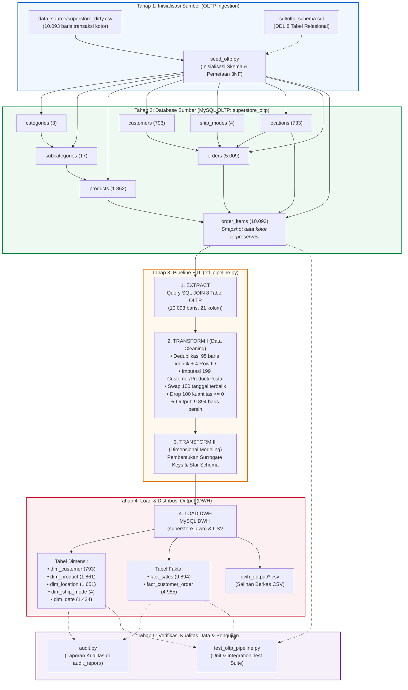

# Panduan Alur Menjalankan Sistem ETL Superstore (OLTP to DWH)

Dokumen ini memuat panduan komprehensif mengenai **alur operasional, diagram alir data, dan langkah-langkah praktis** untuk menjalankan seluruh ekosistem pipeline ETL dari sumber database relasional MySQL OLTP (3NF) ke MySQL Data Warehouse (Star Schema).

---

## 🗺️ 1. Diagram Alur Sistem (End-to-End Flow)



---

## 📁 2. Struktur Direktori Proyek yang Rapi

```
superstore-ETL-dwh/
│
├── sql/                             # Naskah DDL Database
│   ├── oltp_schema.sql              # Skema 8 tabel ternormalisasi OLTP (3NF)
│   └── dwh_schema.sql               # Skema Star Schema Data Warehouse
│
├── data_source/                     # Dataset awal mentah
│   └── superstore_dirty.csv         # 10.093 baris transaksi kotor
│
├── dwh_output/                      # Hasil keluaran Star Schema (CSV)
│   ├── dim_customer.csv
│   ├── dim_product.csv
│   ├── dim_location.csv
│   ├── dim_ship_mode.csv
│   ├── dim_date.csv
│   ├── fact_sales.csv
│   └── fact_customer_order.csv
│
├── audit_report/                    # Hasil laporan kualitas data
│   ├── audit_summary.json
│   ├── table_summary.csv
│   ├── null_audit.csv
│   ├── duplicate_audit.csv
│   ├── business_logic_audit.csv
│   └── key_integrity_audit.csv
│
├── logs/                            # Log eksekusi scheduler Windows
│   ├── etl_latest.log
│   └── etl_YYYYMMDD_HHMMSS.log
│
├── .env.example                     # Template konfigurasi kredensial
├── .env                             # Kredensial aktif lokal (terabaikan di git)
├── .gitignore                       # Proteksi file kredensial dan cache
├── requirements.txt                 # Dependensi pustaka Python
├── README.md                        # Dokumentasi teknis proyek
├── ALUR_SISTEM.md                   # Dokumen panduan alur operasional (file ini)
│
├── etl_pipeline.py                  # Core Engine ETL Pipeline (MySQL -> DWH)
├── seed_oltp.py                     # Ingestion tool: CSV -> MySQL OLTP (3NF)
├── audit.py                         # Quality control & audit runner
├── test_oltp_pipeline.py            # Automated Unit & Integration Test Suite
└── run_etl.bat                      # Windows Task Scheduler automation runner
```

---

## ⚡ 3. Langkah Operasional Menjalankan Sistem

### Langkah 0: Persiapan Lingkungan & Dependensi
Pastikan layanan **MySQL Server** (versi 8.0 / MariaDB) telah aktif pada port `3306`, kemudian pasang seluruh pustaka Python:
```bash
pip install -r requirements.txt
```

---

### Langkah 1: Pengaturan File Konfigurasi Lingkungan (`.env`)
Salin file template `.env.example` menjadi `.env`:
```cmd
copy .env.example .env
```
Pastikan kredensial basis data sesuai dengan lingkungan server Anda:
```ini
# Database Sumber (OLTP)
OLTP_DB_HOST=localhost
OLTP_DB_PORT=3306
OLTP_DB_USER=root
OLTP_DB_PASSWORD=
OLTP_DB_NAME=superstore_oltp

# Database Tujuan (DWH)
DWH_DB_HOST=localhost
DWH_DB_PORT=3306
DWH_DB_USER=root
DWH_DB_PASSWORD=
DWH_DB_NAME=superstore_dwh

LOAD_TO_MYSQL=true
```

---

### Langkah 2: Menyiapkan Skema Database DWH (`superstore_dwh`)
Sebelum memuat data analitik, buat struktur Star Schema di database Data Warehouse:
- **Melalui MySQL CLI**:
  ```bash
  mysql -u root -p < sql/dwh_schema.sql
  ```
- **Atau melalui MySQL Workbench / DBeaver**:
  Buka berkas `sql/dwh_schema.sql` lalu jalankan (**Execute Script**).

---

### Langkah 3: Mengisi Database Sumber OLTP (`superstore_oltp`)
Jalankan skrip seeder relasional untuk membuat 8 tabel ternormalisasi dan memetakan 10.093 baris transaksi mentah:
```bash
python seed_oltp.py
```
> **Catatan Data Engineer**: Proses ini menginjeksi data mentah apa adanya (nilai NULL, tanggal terbalik, dan duplikasi sengaja dipertahankan di level `order_items` sebagai *transaction snapshot*).

---

### Langkah 4: Menjalankan Pipeline ETL
Jalankan pemrosesan ETL end-to-end:
```bash
python etl_pipeline.py
```
*Atau di Windows CLI / Task Scheduler:*
```cmd
run_etl.bat
```

**Rangkaian Eksekusi yang Terjadi:**
1. **Extract**: Mengekstrak data melalui query `SELECT ... JOIN` 8 tabel relasional dari database `superstore_oltp`.
2. **Transform (Clean)**: Membersihkan 95 duplikat identik, 4 duplikat `Row ID`, imputasi 199 sel NULL per kolom, menukar 100 tanggal terbalik, dan membuang 100 kuantitas $\le 0$.
3. **Transform (Model)**: Menghasilkan *Surrogate Keys* berurutan untuk tabel dimensi dan fakta.
4. **Load**: Memuat 7 tabel ke MySQL `superstore_dwh` (dengan pengabaian sementara pemeriksaan Foreign Key untuk menjamin integritas reload) serta mengekspor berkas ke direktori `dwh_output/`.

---

### Langkah 5: Memverifikasi Integritas dan Kualitas Data
Jalankan audit kualitas data:
```bash
python audit.py
```
Hasil audit akan langsung ditampilkan di terminal dan seluruh metrik detail tersimpan di folder `audit_report/`.

---

### Langkah 6: Menjalankan Automated Test Suite
Jalankan seluruh pengujian otomatis untuk memverifikasi kesehatan sistem relasional dan integritas data:
```bash
python test_oltp_pipeline.py
```
Skrip ini akan memvalidasi:
- `test_01_oltp_table_counts`: Memverifikasi jumlah record di 8 tabel OLTP.
- `test_02_foreign_key_integrity`: Memastikan tidak ada *orphan foreign key*.
- `test_03_dirty_data_preservation`: Memastikan nilai NULL, anomali tanggal, dan duplikasi tetap terjaga di OLTP.
- `test_04_relational_extract_grain_and_semantics`: Memastikan ekstraksi JOIN menghasilkan tepat 10.093 baris dan 21 kolom.
- `test_05_clean_and_dwh_compatibility`: Memastikan hasil ekstraksi kompatibel 100% dengan tahap Transform dan DWH.

---

## 🛠️ 4. Panduan Penyelesaian Masalah (Troubleshooting)

| Gejala Masalah | Penyebab Umum | Solusi Praktis |
| :--- | :--- | :--- |
| `Can't connect to MySQL server on 'localhost'` | Service MySQL belum berjalan di port 3306. | Buka Laragon/XAMPP/Services dan jalankan service MySQL. |
| `Table 'superstore_oltp.order_items' doesn't exist` | Database OLTP belum diinisialisasi. | Jalankan `python seed_oltp.py` untuk menginisialisasi 8 tabel relasional sumber. |
| `Cannot drop table 'dim_customer' referenced by foreign key` | Foreign key checks aktif saat reload DWH. | Gunakan fungsi `load_to_mysql()` terintegrasi di `etl_pipeline.py` yang otomatis menangani `SET FOREIGN_KEY_CHECKS = 0;`. |
| `ModuleNotFoundError: No module named 'dotenv'` / `'pymysql'` | Dependensi pustaka belum terpasang. | Jalankan `pip install -r requirements.txt`. |
